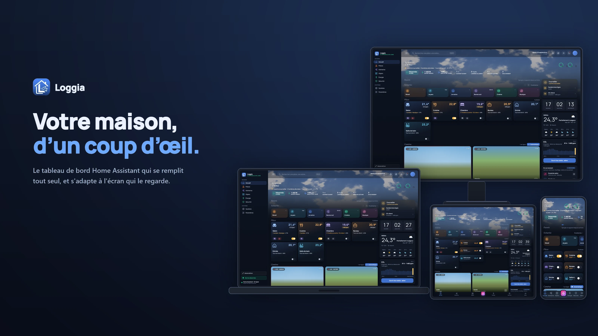

# Loggia pour Home Assistant

[](https://github.com/Alardware/loggia/releases)
[](https://github.com/Alardware/loggia/actions)
[](https://ko-fi.com/alardware)



Un tableau de bord Home Assistant qui se remplit tout seul.

Loggia lit les registres de votre installation (zones, appareils, entités) et
en déduit ce qu'il peut afficher. Aucun identifiant d'entité n'est écrit dans le
code : ce qui n'existe pas chez vous n'apparaît pas, et ce que vous ajoutez plus
tard apparaît sans rien toucher.

Je l'ai construit pour ma maison, et je le partage parce qu'il peut servir la
vôtre. Il s'ouvre comme un panneau de Home Assistant, en plein écran, sans
carte iframe ni module Lovelace à ajouter.

## Essayer sans rien installer

**[La démo en ligne](https://alardware.github.io/loggia/)** monte une maison de
démonstration (pièces, lumières, volets, thermostats, robots, scénarios) que
l'on peut manipuler, avec un profil administrateur pour tout essayer. Elle
tourne entièrement dans le navigateur : rien n'est envoyé nulle part, et tout
s'efface à la fermeture de l'onglet.

## Ce que vous obtenez

Les vues se composent d'après ce que Home Assistant connaît déjà :

| Vue | Ce qu'elle montre |
| --- | --- |
| Accueil | la maison d'un coup d'œil : pièces, météo, caméras, « À surveiller » |
| Pièces | les zones de Home Assistant qui contiennent un équipement |
| Objets | les appareils par familles : lumières, volets, chauffage, prises, multimédia, robots et appareils connectés, capteurs |
| Scénarios | huit proposés d'après vos appareils, plus les vôtres ; une scène ou un script se lie |
| Énergie | le tableau de bord Énergie de Home Assistant (compteur, solaire, appareils suivis) |
| Sécurité | alarme, caméras, personnes, détecteurs |
| Système | processeur, mémoire, disque, température |

Chaque appareil a sa carte, et sa fiche s'ouvre d'un toucher.

**Une vue sans rien à montrer disparaît du menu**, et revient d'elle-même le
jour où l'appareil existe. Paramètres → Vues liste celles qui sont masquées, et
pourquoi.

Et, sans rien régler :

- **les alertes de sûreté** : fumée, monoxyde de carbone, gaz, fuite d'eau,
  sabotage, en tête de l'écran dès qu'un capteur se déclenche ; la vigilance
  météo à part ;
- **l'arrivée d'eau** : sur une fuite, la maison ferme la vanne, et ne la
  rouvre jamais seule ;
- **le journal de chaque pièce** sur vingt-quatre heures ;
- **les caméras en direct**, sur l'Accueil et dans Sécurité ;
- **un minuteur d'extinction** sur les lampes et les prises, tenu par Home
  Assistant même quand aucun écran n'est ouvert ;
- **un mode ambiant** pour une tablette murale ;
- **sept langues** : français, anglais, allemand, néerlandais, italien,
  espagnol, polonais.

Le même tableau de bord s'adapte à l'écran : sur tablette et téléphone, la
navigation passe en bas. C'est le TYPE d'appareil qui décide, jamais
la largeur. Chaque type d'écran garde son propre rangement des
cartes ; le contenu, lui, se synchronise.

## Installation

### HACS (recommandé)

[](https://my.home-assistant.io/redirect/hacs_repository/?owner=Alardware&repository=loggia&category=integration)

1. Cliquez sur le bouton ci-dessus, ou dans HACS : menu ⋮ → *Dépôts
   personnalisés* → URL `https://github.com/Alardware/loggia`, type
   *Intégration* → *Ajouter*.
2. Ouvrez « Loggia Dashboard » dans HACS → *Télécharger*.
3. Redémarrez Home Assistant.

### Manuelle

1. Téléchargez la dernière
   [version](https://github.com/Alardware/loggia/releases).
2. Copiez le dossier `custom_components/loggia` dans le dossier
   `custom_components` de votre configuration Home Assistant. Vous obtenez
   `/config/custom_components/loggia/`. Pour copier, vous pouvez utiliser les
   modules complémentaires *Samba share*, *Studio Code Server* ou *File editor*.
3. Redémarrez Home Assistant.

**Home Assistant 2024.7 ou plus récent est nécessaire.**

## Configuration

1. Paramètres → Appareils et services → **Ajouter une intégration**.
2. Cherchez **Loggia**.
3. Loggia apparaît dans le menu latéral. Il n'y a rien d'autre à faire : ni
   copie dans `www/`, ni tableau de bord YAML.

**Les profils.** Chaque compte Home Assistant ouvre son propre profil Loggia,
créé à sa première visite : ses vues, son thème, son rangement, sur tous ses
écrans. Un administrateur de Home Assistant a un profil administrateur ; les
autres comptes, un profil de la famille.

**Le code administrateur.** Il protège le passage vers un profil
administrateur et les réglages du mode enfant. Il n'y en a pas au départ, et
tant qu'il n'est pas créé, aucun code n'ouvre rien. Un administrateur de Home
Assistant le crée la première fois que Loggia le demande, ou dans Paramètres ›
Profils (4 à 8 chiffres).

**Ce qui se désigne à la main.** Certains appareils n'ont pas d'équivalent
standard dans Home Assistant. Ils se désignent sur la page concernée : **mode
édition**, puis **Entités de la vue** dans le bandeau du haut (Accueil, Objets,
Énergie, Sécurité) :

- les radiateurs **fil pilote** — un `switch` entouré d'aides (consigne, mode,
  automatique) qu'aucune convention ne permet de deviner ;
- le **planning des volets** (mode d'automatisme, jours) ;
- un **distributeur de croquettes** : son appareil, ou son réservoir, sa
  portion et, si besoin, le script qui distribue. Sa fiche — Accueil, Repas,
  Historique, et Entretien quand l'appareil a des consommables — lit les
  repas dans le **programme de
  l'appareil** quand il se lit (Petlibro, PetKit, Aqara, Tuya), et dans les
  **automatisations** de Home Assistant qui le commandent, reconnues à ce
  qu'elles font, jamais à leur nom. Sans l'un ni l'autre, et si Loggia sait
  le commander, un **planning de Loggia** se règle dans la fiche : Home
  Assistant distribue à l'heure, écran fermé, et retient le repas si une
  autre source distribue déjà ;
- les **capteurs de consommable** (filtre, brosse, réservoir) que la veille
  surveille : Home Assistant n'a pas de classe pour eux, on les désigne dans
  Règles › Veilles, et un message part quand il faut remplacer ;
- le **mode invité** : un `input_boolean` de Home Assistant désigné dans
  Règles › Présence. Allumé, la maison ne se met pas en veille et l'extinction
  du coucher attend ; il se coupe seul trente minutes après le retour d'un
  habitant ;
- les capteurs d'énergie d'un package maison, si vous préférez les vôtres à ceux
  que le tableau de bord Énergie expose.

**Vos propres vues.** Un administrateur compose une vue depuis l'interface :
des entités, chacune avec sa carte, et des **cartes template**, dont le contenu
est un template Jinja évalué par Home Assistant et mis à jour en direct.

## Exemple : lancer un scénario depuis une automatisation

Le service `loggia.scenario` lance un scénario de Loggia depuis une
automatisation, l'assistant vocal ou un bouton sans fil. L'identifiant est
`nuit`, `depart`, `retour`, `reveil`, `cinema`, `musique`, `invites`,
`tout_eteindre`, ou `perso_<nom>` pour un des vôtres.

```yaml
automation:
  - alias: "Mode nuit à 23 h"
    triggers:
      - trigger: time
        at: "23:00:00"
    actions:
      - action: loggia.scenario
        data:
          id: nuit
```

## En cas de problème

| Ce que vous voyez | Ce qu'il faut faire |
| --- | --- |
| Loggia n'est pas dans le menu latéral | L'intégration n'est pas ajoutée : Paramètres → Appareils et services → Ajouter une intégration → Loggia. Puis redémarrez Home Assistant. |
| Après une mise à jour, rien n'a changé | L'écran garde l'ancienne version : rechargez la page (Ctrl+F5), ou fermez et rouvrez l'application Home Assistant. |
| Une vue manque | Rien ne l'alimente chez vous. Paramètres → Vues dit pourquoi. |
| Les réglages ne suivent pas d'un écran à l'autre | L'intégration n'est pas ajoutée : sans elle, chaque navigateur garde les siens. |
| « Aucun code n'est encore défini » | Un administrateur de Home Assistant doit créer le code administrateur, dans Paramètres › Profils. |

- Journaux : Paramètres → Système → Journaux, cherchez `loggia`.
- Signalez un problème sur [GitHub](https://github.com/Alardware/loggia/issues)
  en indiquant la version de Loggia et, si possible, une capture d'écran.

## Vos données

- **Les réglages** sont rangés par l'intégration dans
  `.storage/loggia_dashboard_config`, par compte Home Assistant. Avant chaque
  écriture, une copie est gardée (les dix dernières, au plus une par quart
  d'heure) ; Paramètres → À propos permet d'en remettre une.
- **Les commandes passent par Home Assistant**, avec ses autorisations :
  un compte ne peut rien faire dans Loggia qu'il ne puisse déjà faire ailleurs.
  Ce qui modifie la configuration de la maison est réservé aux
  administrateurs (`require_admin`, sur les dix-neuf commandes WebSocket
  concernées).
- **Le code administrateur est haché** par l'intégration et n'est jamais
  renvoyé à un écran. Les essais ratés sont limités.
- Le jeton d'accès Home Assistant n'est lu que **pour les images** : les
  caméras et la carte d'un robot, auprès du proxy d'images de Home Assistant.
  Il n'est ni stocké, ni envoyé ailleurs.
- **Rien ne sort de chez vous** : ni police distante, ni CDN, ni télémétrie.
  Une seule exception : sur l'écran des mises à jour, les logos des
  intégrations viennent de `brands.home-assistant.io`, comme dans Home
  Assistant.

## Développement

```bash
npm install
npm test           # tests du tableau de bord
npm run lint
npm run build      # construit dans dist/

pip install pytest
python -m pytest tests/python -q   # tests de l'intégration
```

La démo (`?demo` sur le serveur de développement) accepte des paramètres
d'aperçu, pour vérifier une traduction, un thème ou une vue d'un seul
chargement : `mode=auto|light|dark`, `lang=<le code d'une des sept langues>`, `theme=<nom du thème>`
(c'est par lui que l'audit de contraste rejoue chaque variante), `vue=<identifiant>` ou `vue=room:<pièce>`,
`fiche=<entity_id>` (ouvre la fiche d'un appareil).
Les décisions du projet sont dans `docs/decisions/`, une par fichier, avec leur
contexte.

## Soutenir

Loggia est développé sur mon temps libre. Si le projet vous est utile, un café
aide à le faire vivre :

[](https://ko-fi.com/alardware)

## Crédits

Polices Manrope (Mikhail Sharanda) et Newsreader (Production Type), sous SIL
Open Font License 1.1. Icônes de l'interface : [UIcons par Flaticon](https://www.flaticon.com/uicons).
Icônes météo : Meteocons, de Bas Milius (`@bybas/weather-icons`), sous licence
MIT. React et three.js, sous licence MIT. Tout est embarqué : rien n'est chargé
depuis ces sites.

## Licence

MIT — voir [LICENSE](LICENSE).
