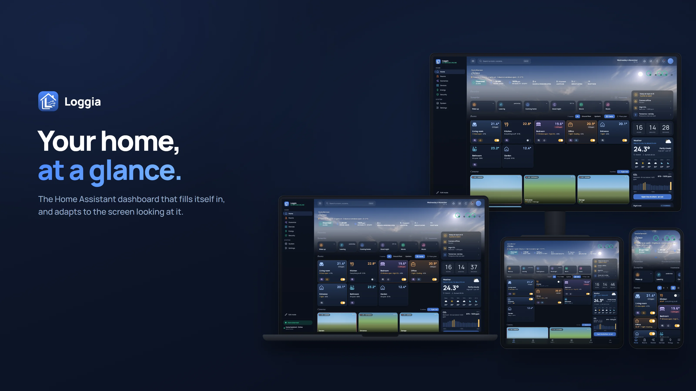

# Loggia for Home Assistant

[](https://github.com/Alardware/loggia/releases)
[](https://github.com/Alardware/loggia/releases)
[](https://github.com/Alardware/loggia/actions)
[](https://ko-fi.com/alardware)

*Version française : [README.fr.md](README.fr.md)*



A Home Assistant dashboard that fills itself in.

Loggia reads the registries of your installation (areas, devices, entities) and
works out what it can show. No entity ID is written in the code: what you don't
have doesn't appear, and what you add later shows up without touching anything.

I built it for my own home, and I share it because it may serve yours. It opens
as a Home Assistant panel, full screen, with no iframe card or Lovelace module
to add.

## Try it without installing anything

**[The live demo](https://alardware.github.io/loggia/)** sets up a sample home
(rooms, lights, shutters, thermostats, robots, scenarios) that you can play
with, with an administrator profile to try everything. It runs entirely in the
browser: nothing is sent anywhere, and everything is wiped when you close the
tab.

## What you get

The views build themselves from what Home Assistant already knows:

| View | What it shows |
| --- | --- |
| Home | the house at a glance: rooms, weather, cameras, “Keep an eye on it” |
| Rooms | the Home Assistant areas that contain a device |
| Devices | devices by family: lights, shutters, heating, plugs, media, robots and connected devices, sensors |
| Scenarios | eight suggested from your devices, plus your own; a scene or a script can be linked |
| Energy | the Home Assistant Energy dashboard (meter, solar, tracked devices) |
| Security | alarm, cameras, people, detectors |
| System | processor, memory, disk, temperature |

Each device has its card, and its sheet opens with a tap.

**A view with nothing to show disappears from the menu**, and comes back by
itself the day the device exists. Settings → Views lists the hidden ones, and
why.

And, with nothing to set up:

- **safety alerts**: smoke, carbon monoxide, gas, water leak, tampering, at the
  top of the screen as soon as a sensor triggers; weather warnings apart;
- **the water inlet**: on a leak, the house closes the valve, and never reopens
  it by itself;
- **each room's log** over twenty-four hours;
- **live cameras**, on Home and in Security;
- **a switch-off timer** on lamps and plugs, kept by Home Assistant even when
  no screen is open;
- **an ambient mode** for a wall tablet;
- **seven languages**: French, English, German, Dutch, Italian, Spanish,
  Polish.

The same dashboard adapts to the screen: on tablets and phones, navigation
moves to the bottom. It is the device TYPE that decides, never the width.
Each type of screen keeps its own card layout; the content is synced.

## Installation

### HACS (recommended)

[](https://my.home-assistant.io/redirect/hacs_repository/?owner=Alardware&repository=loggia&category=integration)

1. Click the button above, or in HACS: ⋮ menu → *Custom repositories* → URL
   `https://github.com/Alardware/loggia`, type *Integration* → *Add*.
2. Open “Loggia Dashboard” in HACS → *Download*.
3. Restart Home Assistant.

### Beta versions

Every version first goes through a beta (`3.98.0-beta.1`, for example), which I
install at home before anyone else. To get it too:

1. Settings → Devices & services → *HACS* → entities: enable, then turn on, the
   *Pre-release* switch of “Loggia Dashboard” (it is disabled by default).
2. The beta then arrives like any other update.

To go back to the stable version: turn the switch off, then HACS → “Loggia
Dashboard” → ⋮ → *Redownload* → pick the latest version without `-beta`.

### Manual

1. Download `loggia.zip` from the latest
   [release](https://github.com/Alardware/loggia/releases).
2. Unzip it into a `loggia` folder inside the `custom_components` folder of
   your Home Assistant configuration. You get `/config/custom_components/loggia/`.
   To copy files, you can use the *Samba share*, *Studio Code Server* or *File
   editor* add-ons.
3. Restart Home Assistant.

**Home Assistant 2024.7 or newer is required.**

## Setup

1. Settings → Devices & services → **Add integration**.
2. Search for **Loggia**.
3. Loggia appears in the sidebar. There is nothing else to do: no copy into
   `www/`, no YAML dashboard.

**Profiles.** Each Home Assistant account opens its own Loggia profile, created
on its first visit: its views, its theme, its layout, on all its screens. A
Home Assistant administrator gets an administrator profile; the other accounts,
a family profile.

**The administrator code.** It guards the switch to an administrator profile
and the child mode settings. There is none at first, and until it is created,
no code opens anything. A Home Assistant administrator creates it the first
time Loggia asks, or in Settings › Profiles (4 to 8 digits).

**What you point out by hand.** Some devices have no standard counterpart in
Home Assistant. You point them out on the page concerned: **Edit mode**, then
**Entities of this view** in the top banner (Home, Devices, Energy, Security):

- **pilot wire** radiators — a `switch` surrounded by helpers (setpoint, mode,
  automatic) that no convention lets anyone guess;
- the **shutter schedule** (automation mode, days);
- a **pet feeder**: its device, or its tank, its portion and, if needed, the
  script that feeds. Its sheet — Home, Meals, History, and Maintenance when the
  device has consumables — reads the meals from the **device's own schedule**
  when it can be read (Petlibro, PetKit, Aqara, Tuya), and from the Home
  Assistant **automations** that command it, recognised by what they do, never
  by their name. With neither, and if Loggia knows how to command it, a
  **Loggia schedule** is set in the sheet: Home Assistant feeds on time, screen
  closed, and holds the meal back if another source already feeds;
- the **consumable sensors** (filter, brush, tank) that the watches keep an eye
  on: Home Assistant has no class for them, you point them out in Rules ›
  Watches, and a message goes out when something needs replacing;
- **guest mode**: a Home Assistant `input_boolean` pointed out in Rules ›
  Presence. When on, the house doesn't go to sleep and the bedtime switch-off
  waits; it turns itself off thirty minutes after someone living there comes
  back;
- the energy sensors of a home-made package, if you prefer yours to those the
  Energy dashboard exposes.

**Your own views.** An administrator builds a view from the interface: entities,
each with its card, and **template cards**, whose content is a Jinja template
evaluated by Home Assistant and updated live.

## Example: starting a scenario from an automation

The `loggia.scenario` action starts a Loggia scenario from an automation, the
voice assistant or a wireless button. The ID is `nuit` (night), `depart`
(leaving), `retour` (coming home), `reveil` (wake-up), `cinema`, `musique`
(music), `invites` (guests), `tout_eteindre` (all off), or `perso_<name>` for
one of yours.

```yaml
automation:
  - alias: "Night mode at 11 pm"
    triggers:
      - trigger: time
        at: "23:00:00"
    actions:
      - action: loggia.scenario
        data:
          id: nuit
```

## Troubleshooting

| What you see | What to do |
| --- | --- |
| Loggia is not in the sidebar | The integration isn't added: Settings → Devices & services → Add integration → Loggia. Then restart Home Assistant. |
| After an update, nothing changed | The screen keeps the old version until it reloads. Loggia says so with “A new version of Loggia is installed.”: tap *Reload*. Otherwise, reload the page (Ctrl+F5), or close and reopen the Home Assistant app. |
| A view is missing | Nothing feeds it at your place. Settings → Views says why. |
| Settings don't follow from one screen to another | The integration isn't added: without it, each browser keeps its own. |
| “No code has been set yet” | A Home Assistant administrator must create the administrator code, in Settings › Profiles. |

- Logs: Settings → System → Logs, search for `loggia`.
- Report a problem on [GitHub](https://github.com/Alardware/loggia/issues),
  with the Loggia version and, if possible, a screenshot. Attach the
  diagnostics: Loggia → Settings → About → *Diagnostics*, or Settings → Devices
  & services → Loggia → ⋮ → *Download diagnostics*. The file describes the
  shape of your configuration, without any name, address or code.

## Your data

- **Settings** are stored by the integration in
  `.storage/loggia_dashboard_config`, per Home Assistant account. Before each
  write, a copy is kept (the last ten, at most one per quarter of an hour);
  Settings → About lets you restore one.
- **Commands go through Home Assistant**, with its permissions: an account
  can't do anything in Loggia that it couldn't already do elsewhere. What
  changes the configuration of the house is reserved for administrators
  (`require_admin`, on the twenty WebSocket commands concerned).
- **The administrator code is hashed** by the integration and never sent back
  to a screen. Failed attempts are limited.
- The Home Assistant access token is only read **for images**: cameras and a
  robot's map, through Home Assistant's image proxy. It is neither stored nor
  sent anywhere else.
- **The map** of people and trackers takes its tiles from Home Assistant's own
  tile relay, as Home Assistant's map does.
- **Nothing leaves your home**: no remote font, no CDN, no telemetry. One
  exception: on the updates screen, the integration logos come from
  `brands.home-assistant.io`, as in Home Assistant.

## Development

```bash
npm install
npm test           # dashboard tests
npm run lint
npm run build      # builds into dist/

pip install pytest
python -m pytest tests/python -q   # integration tests
```

The demo (`?demo` on the development server) accepts preview parameters, to
check a translation, a theme or a view in a single load: `mode=auto|light|dark`,
`lang=<the code of one of the seven languages>`, `theme=<theme name>` (the
contrast audit replays each variant through it), `vue=<id>` or
`vue=room:<room>`, `fiche=<entity_id>` (opens a device's sheet).
The project's decisions are in `docs/decisions/`, one per file, with their
context (in French).

## Support

Loggia is developed in my spare time. If the project is useful to you, a coffee
helps keep it alive:

[](https://ko-fi.com/alardware)

## Credits

Manrope (Mikhail Sharanda) and Newsreader (Production Type) fonts, under the
SIL Open Font License 1.1. Interface icons: [UIcons by Flaticon](https://www.flaticon.com/uicons).
Weather icons: Meteocons, by Bas Milius (`@bybas/weather-icons`), under the MIT
license. React and three.js, under the MIT license; Leaflet, for the map, under
the BSD 2-clause license. All of this is bundled: nothing is loaded from these
sites. The map of the online demo shows OpenStreetMap tiles (© OpenStreetMap
contributors).

## License

MIT — see [LICENSE](LICENSE).
